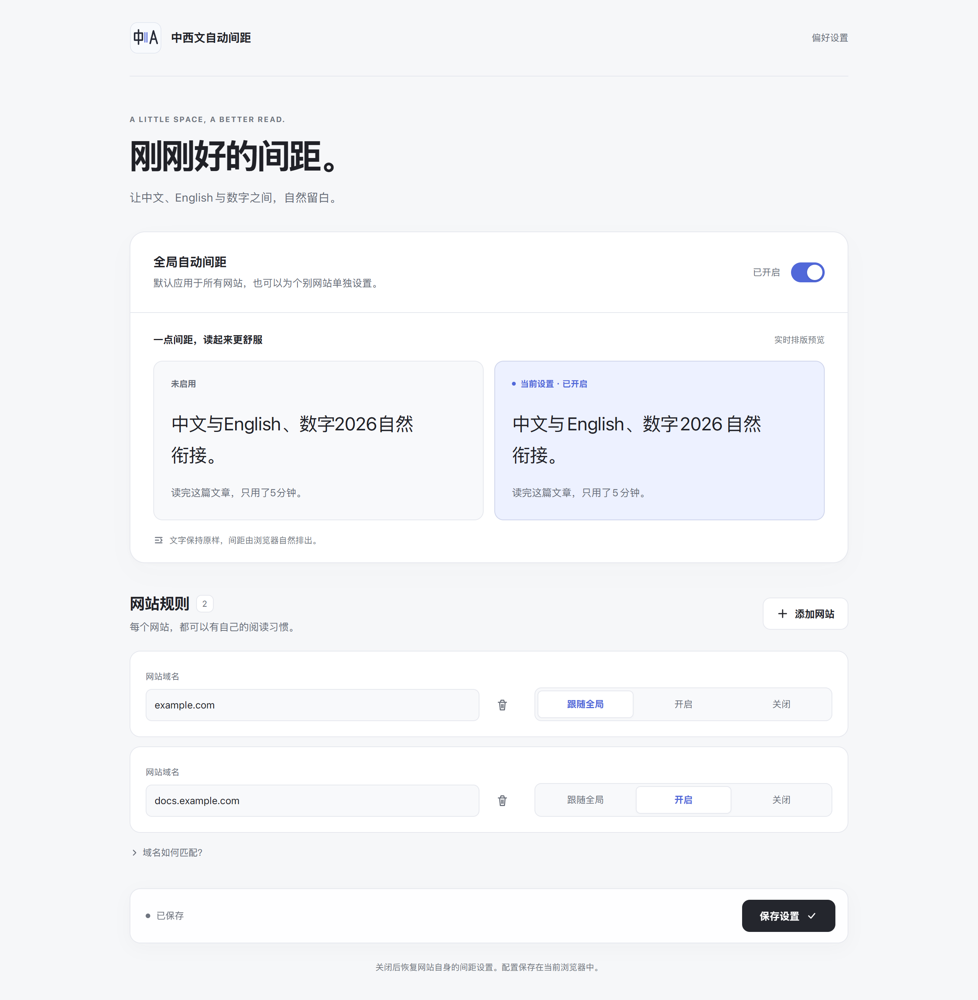

# 中西文自动间距

**字里行间，自有留白。**

中文、西文与数字相遇时，一点间距就能让阅读更从容。中西文自动间距为 Chrome、Edge 等 Chromium 浏览器开启原生排版间距：安装后默认全局生效，也可以为每个网站单独选择。

[下载安装](https://github.com/Speechlessmanbilibili/native-auto-space/releases/latest) · [开始使用](#安装与开始使用) · [更新日志](CHANGELOG.md) · [反馈问题](https://github.com/Speechlessmanbilibili/native-auto-space/issues)

<picture>
  <source media="(prefers-color-scheme: dark)" srcset="docs/ui/options-dark.png">
  
</picture>

[完整设置页](docs/ui/options-full.png) · [工具栏弹窗](docs/ui/popup-light.png) · [窄屏布局](docs/ui/options-mobile.png)

## 留白发生在排版里

预览中的原文是：

```text
中文与English、数字2026自然衔接。
读完这篇文章，只用了5分钟。
```

文字内容保持原样，间距由浏览器的 `text-autospace` 排出。复制、编辑和搜索继续使用原文，字体、字号及连字设置沿用网站样式。

- **默认全局开启**：让普通网页中的中西文与数字自然分隔。
- **本站即时切换**：在工具栏弹窗选择“跟随全局/开启/关闭”。
- **边切换，边对照**：设置页并排展示未启用效果与当前设置，全局开关实时联动右侧预览。
- **随页面出现而生效**：提前注册样式，在 `document_start` 加载；后来出现的文字也沿用间距规则。
- **浅色与暗色都清楚**：书页式设置页与书签式弹窗采用同系列纸色、墨色和朱砂控件。

## 安装与开始使用

1. 从 [最新 Release](https://github.com/Speechlessmanbilibili/native-auto-space/releases/latest) 下载 `native-auto-space-v<VERSION>.zip`。
2. 打开 `edge://extensions/` 或 `chrome://extensions/`，开启开发者模式，将 ZIP 拖入扩展管理页。
3. 打开普通网页，点击工具栏中的扩展图标，即可查看当前网站的间距状态。

“管理所有网站设置”打开完整设置页。可以在那里对照效果、编辑网站规则并保存。

需要浏览器支持 `text-autospace`；设置页会在缺少支持时显示更新提示。本地文件页面需在扩展管理页允许访问文件网址。

更新时拖入新版 ZIP，覆盖原扩展并沿用设置。固定扩展 ID：`hciemeeoeagloegjphmccjmhlmdhjkfa`。

## 每个网站，留多少选择给自己

| 本站选项 | 效果 |
|---|---|
| 跟随全局 | 沿用全局开关 |
| 开启 | 为本站启用自动间距，全局关闭时也生效 |
| 关闭 | 移除扩展的间距设置，恢复网站自身排版 |

网站本来就开启了自动间距时，选择“关闭”仍保留网站原有的间距。

规则可精确到子域名与端口：

| 规则示例 | 匹配范围 |
|---|---|
| `example.com` | 主域名及其子域名 |
| `docs.example.com` | 该子域名及其下级子域名，优先于上一级规则 |
| `example.com:443` | 对应域名及其子域名的 443 端口 |

不填端口时匹配全部端口。同一主机下，端口规则优先；同等条件按列表顺序处理。更具体的“跟随全局”规则也会覆盖较宽泛的本站规则。

弹窗显示当前匹配结果，修改会即时保存；完整设置页通过“保存设置”统一保存草稿。

## 轻量的排版方式

扩展通过 CSS 启用 `text-autospace: normal`。浏览器负责安排间距，扩展负责全局开关、站点匹配与样式的注入和移除。

配置保存在当前浏览器的 `chrome.storage.local` 中。页面地址用于匹配规则，页面文字与输入内容由网页和浏览器管理。详见 [隐私说明](PRIVACY.md)。

<details>
<summary>样式覆盖与页面范围</summary>

扩展按全局和站点规则预注册 `document_start` 样式，并由后台补充 `USER` 样式以覆盖网站的间距声明。关闭时清理扩展样式并恢复网页设置。

动态节点、普通 DOM 中的伪元素与占位文字沿用 CSS 规则。Shadow DOM 内部按自身样式和宿主传入的继承值排版。普通框架按自身地址匹配；`about:blank`、`srcdoc`、`blob:` 和 `data:` 框架沿用创建来源的域名与端口。

浏览器内部页、扩展商店等受保护页面受浏览器注入限制。

</details>

## 想连字体一起调整？

- [字体替换器](https://github.com/Speechlessmanbilibili/system-font-substituter)：按名单替换网页字体，提供站点规则、连字与自定义 CSS。
- [中西文字体替换](https://github.com/Speechlessmanbilibili/chinese-western-font-replacer)：搭配中文、西文、共用标点以及衬线组合。

三个扩展可以分别安装、独立配置。本扩展面向整个网页提供自动间距；字体替换器内的间距选项作用于其替换目标。

## 开发与构建

```powershell
npm ci
npx playwright install chromium
npm test
npm run build
```

构建产物为 `dist/native-auto-space-v<VERSION>.zip`，版本 ZIP 同时复制到系统下载目录。开发与发布约定见 [AGENTS.md](AGENTS.md)。

站点地址解析沿用[字体替换器](https://github.com/Speechlessmanbilibili/system-font-substituter)的实现，间距功能与界面独立维护。

## 开源与反馈

采用 [GNU GPL v3.0 或更新版本](LICENSE)（GPL-3.0-or-later）。

[查看更新日志](CHANGELOG.md) · [报告问题或提出建议](https://github.com/Speechlessmanbilibili/native-auto-space/issues) · [隐私说明](PRIVACY.md)
